# 电子相册系统面向对象需求分析报告

南京师范大学 计算机与电子信息学院 计算机科学与技术

编制日期：2026 年 10 月 28 日。成员学号、班级、指导教师及贡献比例待组长确认。

## 1 系统目标

本系统针对个人电脑中照片数量多、分类不清及分享不便的问题，提供基于 Web 的电子相册管理。需求分析围绕老师给定的八个用例展开，采用 B/S 体系结构和 MVC 思路，为后续面向对象设计与系统实现提供统一依据。

普通用户可注册、登录、创建和修改相册、上传和浏览照片、对照片评论；管理员复用登录并维护相册类别。分享面向所有登录用户：他人公开相册可见，本人私有相册仅本人可见。评论删除作为评论用例的扩展流程。本系统不支持视频、点赞、关注、信息流或好友机制。

本报告按老师模板将功能描述与逻辑分析分别编排。所有功能及非功能指标均为需求或后续验收目标，不代表已经实现或实测达标。报告保留现有图稿风格，统一图号、图名及对应说明；未确认的成员信息与贡献比例明确列为待确认。

## 2 功能需求

### 2.1 系统结构

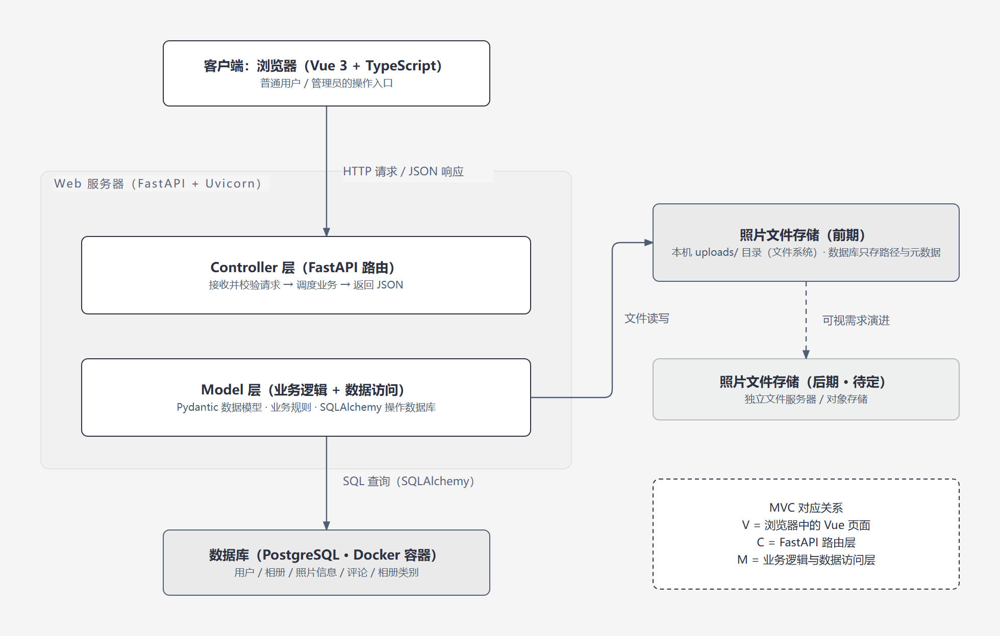

图 2-1 系统体系结构图

图 2-1 表示开发期全系统在同一台本机运行。浏览器承担交互，FastAPI 进程组织业务，PostgreSQL 容器存储结构化数据，uploads/ 保存图片与缩略图。图中后期独立文件服务仅表示可演进方向，不是当前云部署。MVC 的职责分离与物理部署层次应分别理解。

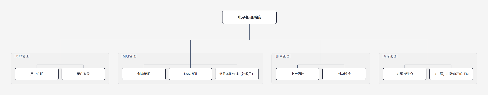

图 2-2 功能框架图

图 2-2 按账户、相册、照片、评论四个功能模块组织八个用例。相册类别维护在功能框架中属于相册管理，答辩分工则与评论共用一个交付组；功能划分与成员分工的两种组织方式不改变功能范围。管理员复用登录，评论删除属于扩展流程。

### 2.2 功能描述

#### 2.2.1 账户管理

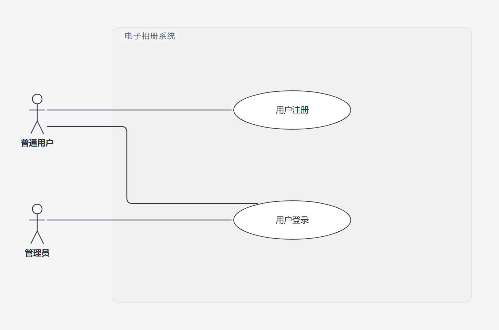

图 2-3 账户管理模块用例图

普通用户参与注册与登录，管理员只参与登录。注册的发起者是尚未注册的访客，图中按题目使用普通用户表示其注册后身份；管理员账户预置，注册不能选择管理员角色。

##### 2.2.1.1 用户注册

- 用例名称：用户注册

- 参与者：访客（未注册用户）

- 前置条件：无

- 基本流程：

1. 用户打开注册页面；

2. 输入用户名、密码、确认密码、邮箱；

3. 系统检查用户名是否已被注册；

4. 用户名可用，系统创建新账户；

5. 提示注册成功，自动跳转登录页面。

- 扩展流程：

- 2a. 两次输入密码不一致，系统提示错误，返回步骤 2；

- 2b. 输入信息不完整（必填项为空），系统提示补全，返回步骤 2；

- 3a. 用户名已存在，系统提示"该用户名已被占用"，返回步骤 2。

- 后置条件：系统中新增一个普通用户账户。

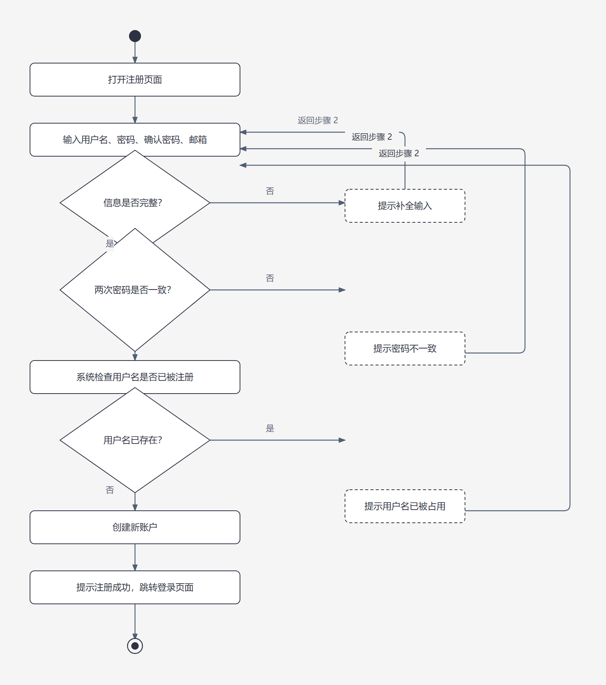

图 2-4 用户注册活动图

图中三项校验分别处理信息不全、密码不一致和用户名已存在，失败均返回输入；只有全部通过才创建普通账户并跳转登录页。错误回路交叉处使用跨越符号表示不相连。

##### 2.2.1.2 用户登录

- 用例名称：用户登录

- 参与者：普通用户、管理员（管理员是特殊用户，复用本用例，不单独设"管理员登录"用例）

- 前置条件：用户已注册（账户已存在）

- 基本流程：

1. 用户打开登录页面；

2. 输入用户名和密码；

3. 系统验证用户名和密码；

4. 验证通过，系统根据账户角色跳转：普通用户进入个人主页，管理员进入后台管理页。

- 扩展流程：

- 2a. 用户名或密码为空，系统提示补全，返回步骤 2；

- 3a. 用户名不存在或密码错误，系统提示"用户名或密码错误"，返回步骤 2。

- 后置条件：用户处于登录状态，系统记录当前登录用户及其角色。

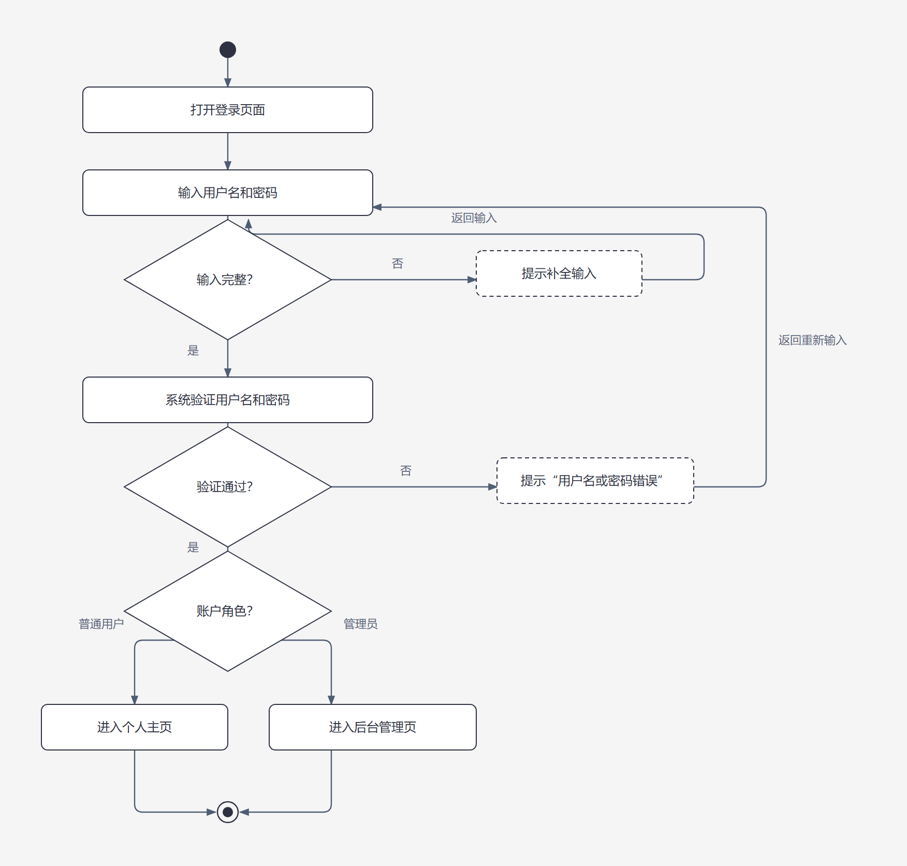

图 2-5 用户登录活动图

输入完整性与账户验证失败均返回输入；验证成功后才按账户角色分别进入个人主页或后台管理页。角色分支的参与者包含普通用户和管理员，普通用户不能进入后台。

#### 2.2.2 相册管理

图 2-6 相册管理模块用例图

普通用户参与创建相册和修改相册。创建时关联当前用户，修改仅由相册所有者执行；类别字典由管理员通过另一个用例维护。

##### 2.2.2.1 创建相册

- 用例名称：创建相册

- 参与者：普通用户

- 前置条件：用户已登录

- 基本流程：

1. 用户进入"我的相册"页面，点击"创建相册"；

2. 系统显示创建表单：相册名称、相册类别（系统类别列表）、公开/私有设置；

3. 用户填写信息并提交；

4. 系统校验（名称非空、类别已选）；

5. 系统创建相册，并关联到当前用户；

6. 提示创建成功，返回相册列表，新相册出现在列表中。

- 扩展流程：

- 4a. 相册名称为空或未选类别，系统提示错误，返回步骤 3。

- 后置条件：系统中新增一个属于当前用户的相册。

图 2-7 创建相册活动图

主流程依次显示表单及类别列表、接收提交、校验、创建并关联当前用户、返回相册列表。判断“名称为空或未选类别？”为是时提示错误并返回填写步骤，为否时创建相册；分支与扩展流程 4a 一致。

##### 2.2.2.2 修改相册

- 用例名称：修改相册

- 参与者：普通用户（相册所有者）

- 前置条件：用户已登录，相册已存在

- 基本流程：

1. 用户在相册列表中选择相册，点击"修改"；

2. 系统显示该相册的现有信息；

3. 用户修改相册名称、类别或公开/私有属性并提交；

4. 系统校验；

5. 系统更新相册信息；

6. 提示修改成功，返回相册列表。

- 扩展流程：

- 4a. 名称为空，系统提示错误，返回步骤 3；

- 1a. 相册不存在或已被删除，系统提示，返回相册列表。

- 后置条件：相册信息被更新（如私有改公开后，其他用户可浏览）。

权限补充：后端校验当前用户是相册所有者；不存在或无权修改时不更新相册。

图 2-8 修改相册活动图

先选择相册并检查是否存在，不存在时提示并返回相册列表后结束本次修改；存在时展示原信息，接收修改。判断“名称为空？”为是时提示并返回修改输入，为否时更新并返回列表，覆盖扩展流程 1a、4a。

#### 2.2.3 照片管理

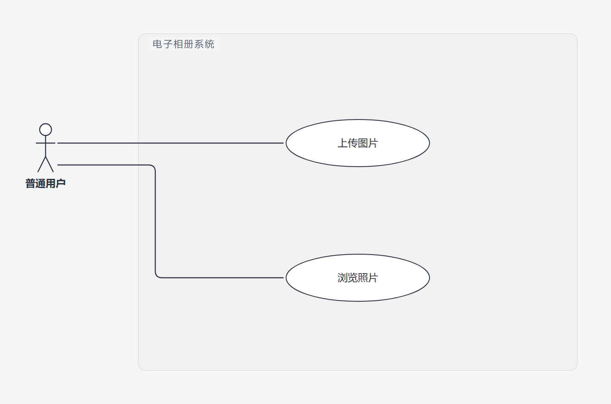

图 2-9 照片管理模块用例图

普通用户参与上传图片与浏览照片。上传发生在已有的本人相册内，浏览范围由公开属性和所有者身份决定；用例图表示参与关系，具体权限和失败处理在活动图中展开。

##### 2.2.3.1 上传图片

- 用例名称：上传图片

- 参与者：普通用户

- 前置条件：用户已登录，目标相册已存在

- 基本流程：

1. 用户进入目标相册，点击"上传图片"；

2. 系统显示文件选择窗口；

3. 用户选择本地图片文件并提交；

4. 系统校验文件格式（jpg/png/gif）和大小（不超过 10MB）；

5. 校验通过，系统保存图片文件并生成缩略图，记录上传者和上传时间；

6. 提示上传成功，照片显示在相册中。

- 扩展流程：

- 4a. 格式或大小不符合要求，系统提示"仅支持 jpg/png/gif，且不超过 10MB"，返回步骤 3。

- 后置条件：相册中新增一张照片（记录上传者、所属相册、上传时间）。

权限补充：上传对象限定为本人相册；图片保存于本机文件系统，数据库仅记录路径和元数据。对应后续安全性与数据完整性验收，不增加题目之外的功能。

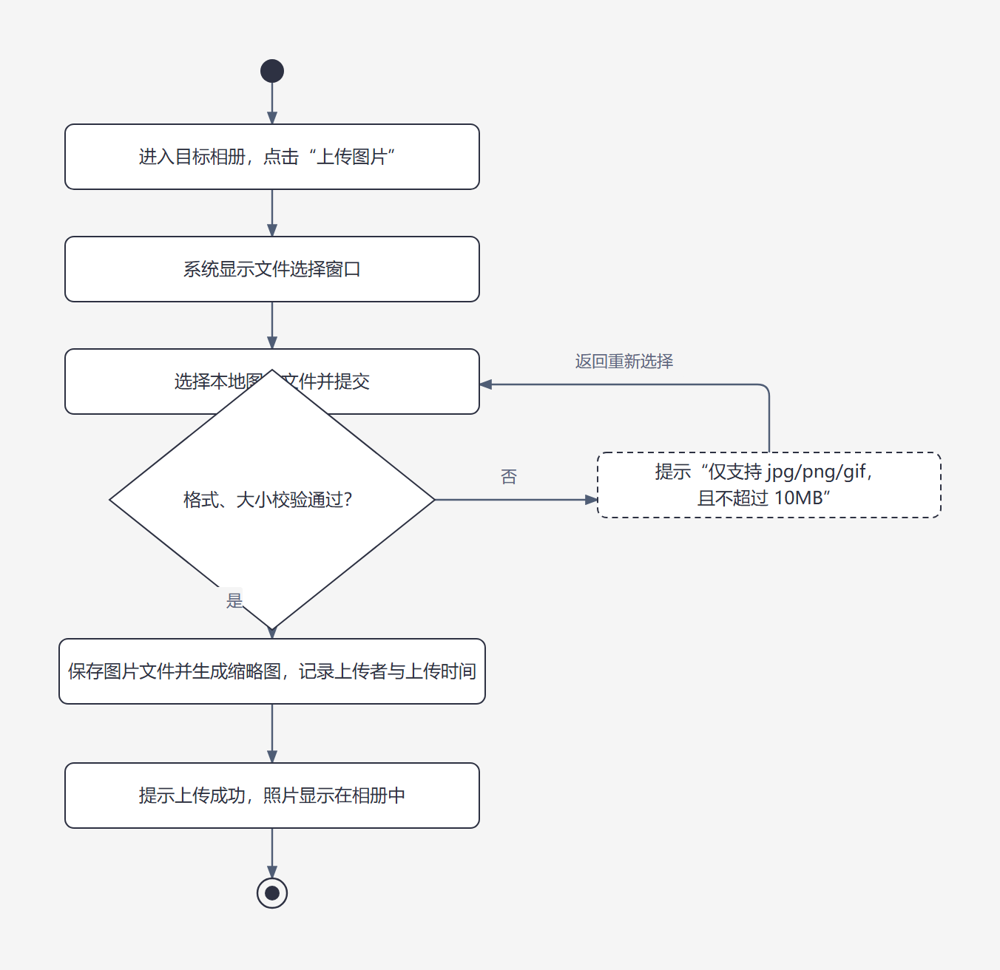

图 2-10 上传图片活动图

进入相册并打开文件选择窗口，用户选择图片提交，系统检查 jpg/png/gif 格式及不超过 10MB 的大小限制。校验通过后保存文件、生成缩略图并记录上传者和时间；不通过时提示限制并返回选择文件，覆盖扩展流程 4a。

##### 2.2.3.2 浏览照片

- 用例名称：浏览照片

- 参与者：普通用户

- 前置条件：用户已登录

- 基本流程：

1. 用户进入浏览页面，系统显示所有公开相册列表（含本人的全部相册）；

2. 用户点击某个相册；

3. 系统显示该相册内照片的缩略图网格；

4. 用户点击某张缩略图；

5. 系统显示照片大图及照片信息（拍摄/上传时间、上传者、评论列表）。

- 扩展流程：

- 1a. 不存在任何可见相册，系统显示"暂无相册"；

- 2a/链接直达：若用户访问他人私有相册，系统提示"该相册为私有，无权查看"，返回步骤 1。

- 后置条件：无（只读操作，不改变系统状态）。

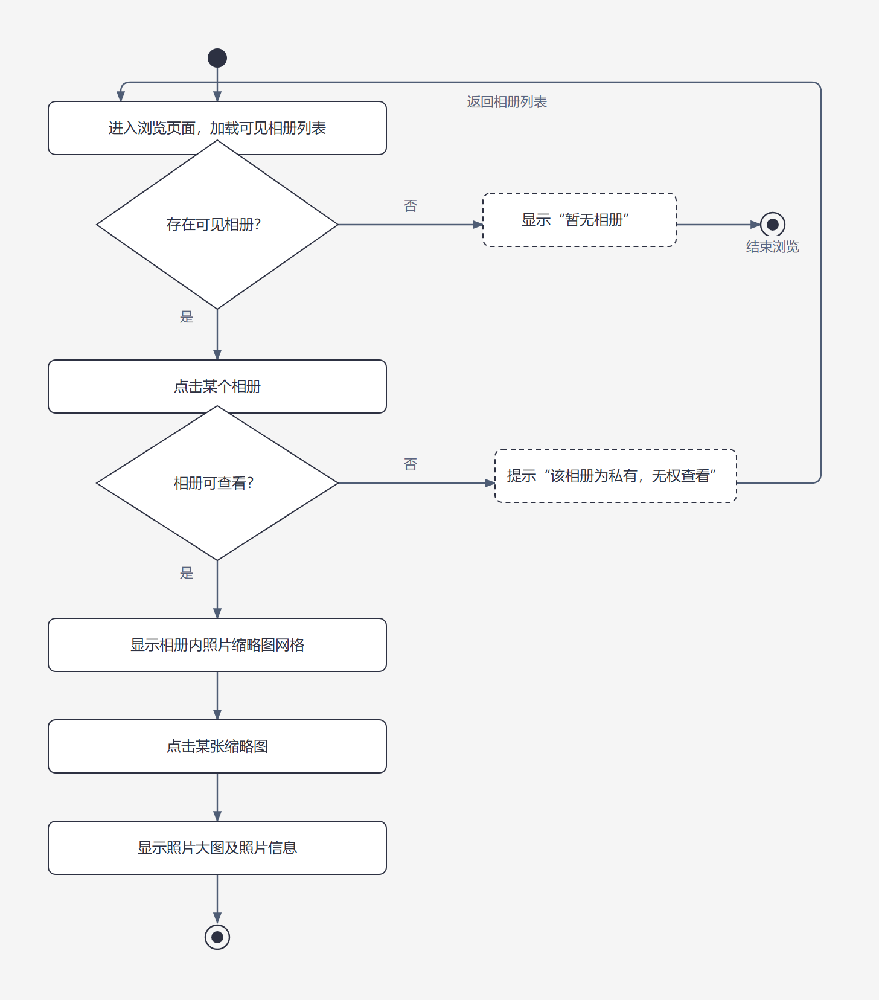

图 2-11 浏览照片活动图

正常入口先加载公开相册与本人全部相册，无可见相册时提示“暂无相册”并结束；存在时选择相册。链接直达入口绕过列表选择，但与正常入口汇入同一个“相册可查看？”判断。访问他人私有相册时提示无权查看并返回加载列表；允许访问才显示缩略图，点击后展示大图、时间、上传者和评论列表。

#### 2.2.4 类别与评论

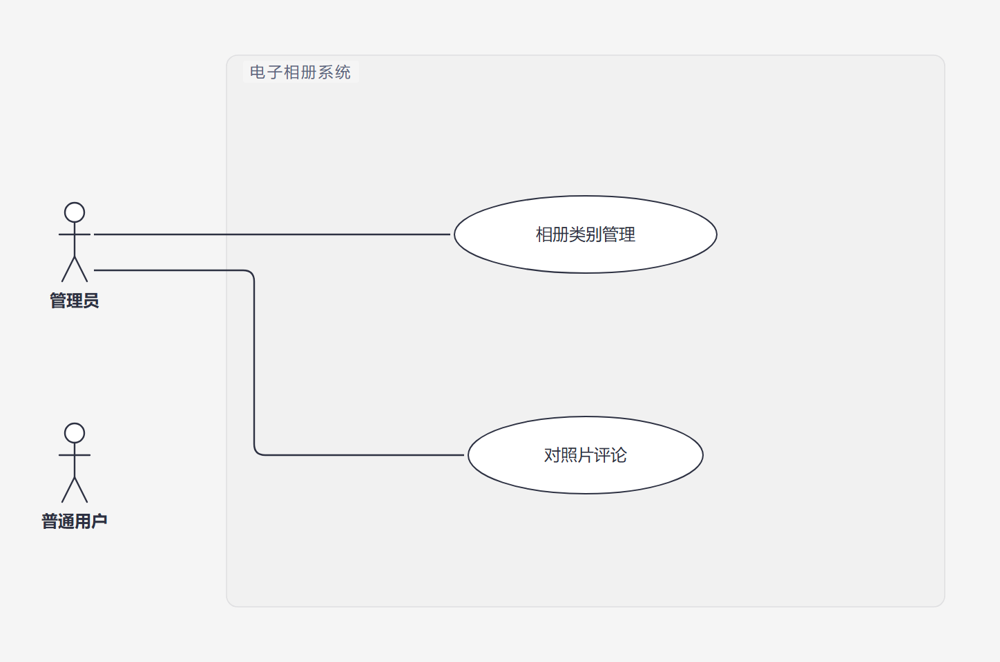

图 2-12 类别与评论模块用例图

管理员参与相册类别管理，普通用户参与对照片评论。评论删除并非新增用例，而是评论的扩展流程；两种角色仍复用既有登录用例。

##### 2.2.4.1 相册类别管理

- 用例名称：相册类别管理

- 参与者：管理员

- 前置条件：管理员已登录并进入后台。

- 基本流程：

1. 管理员进入后台“相册类别管理”页面；

2. 系统显示现有类别列表；

3. 管理员执行添加、修改或删除类别操作并提交；

4. 系统更新类别字典；

5. 系统提示操作成功并刷新类别列表。

- 扩展流程：

- 3a. 新类别名称为空或与已有类别重名，系统提示错误并返回当前编辑操作；

- 4a. 删除类别时，若该类别下仍存在相册，系统提示“该类别下存在相册，不能删除”，返回步骤 2。

- 后置条件：类别字典更新，“创建相册”的可选类别随之变化。

校验口径：名称校验仅用于添加或修改，修改查重排除当前类别；删除只检查类别占用，不要求重新输入类别名称。

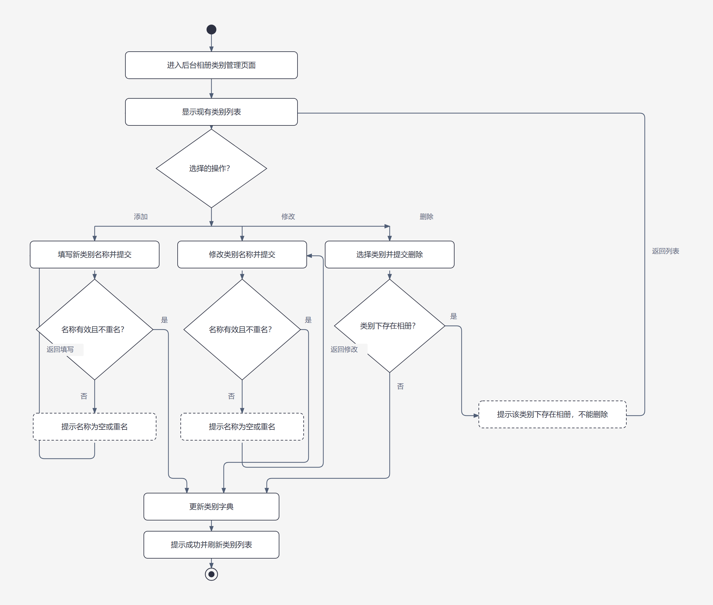

图 2-13 相册类别管理活动图

显示类别列表后提交添加、修改或删除操作。添加与修改共用名称校验分支，修改查重排除当前类别；名称为空或重名时提示并返回操作输入。删除分支绕过名称校验，先检查类别是否仍有相册：有则提示并返回列表，无则删除。保存或删除成功后统一提示并刷新列表，覆盖扩展流程 3a、4a。

##### 2.2.4.2 对照片评论

- 用例名称：对照片评论

- 参与者：普通用户

- 前置条件：用户已登录，照片对其可见（公开相册中的照片或本人相册中的照片）。

- 基本流程：

1. 用户在照片大图页输入评论内容，点击“发表”；

2. 系统校验评论内容非空且不超过 200 字；

3. 系统保存评论，关联评论用户与照片，并记录评论时间；

4. 评论按时间倒序显示在照片下方的评论列表中。

- 扩展流程：

- 2a. 内容为空或超过 200 字，系统提示错误并返回步骤 1；

- 4a. 用户对自己发表的评论点击“删除”，系统显示确认提示，用户确认后移除该评论并刷新列表；若取消则保留评论并返回列表。

- 后置条件：照片新增一条评论记录；执行删除扩展流程时，相应评论记录被移除。

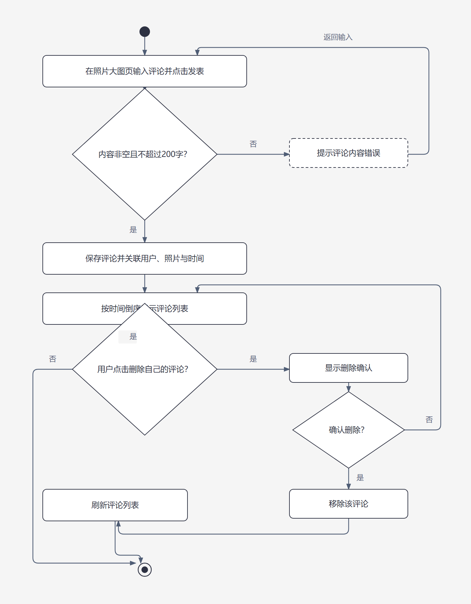

图 2-14 对照片评论活动图

输入评论后判断内容非空且不超过 200 字，不通过时提示并返回输入；通过时保存评论及关联信息，按时间倒序显示。用户选择删除自己的评论后显示确认，确认才移除并刷新；取消时保留评论并返回列表，不删除时结束本次活动。

### 2.3 逻辑分析与建模

采用边界、控制、实体三类分析职责。边界类承担输入与展示，控制类组织一次用例的规则与处理顺序，实体类表达业务数据及相关行为。以下关联的多重性按本图语境解释，特别是控制器查询结果的 0..1，不应误读成全系统只允许一个对象。分析类尚不直接等同于最终代码类或数据库表。

#### 2.3.1 用户注册

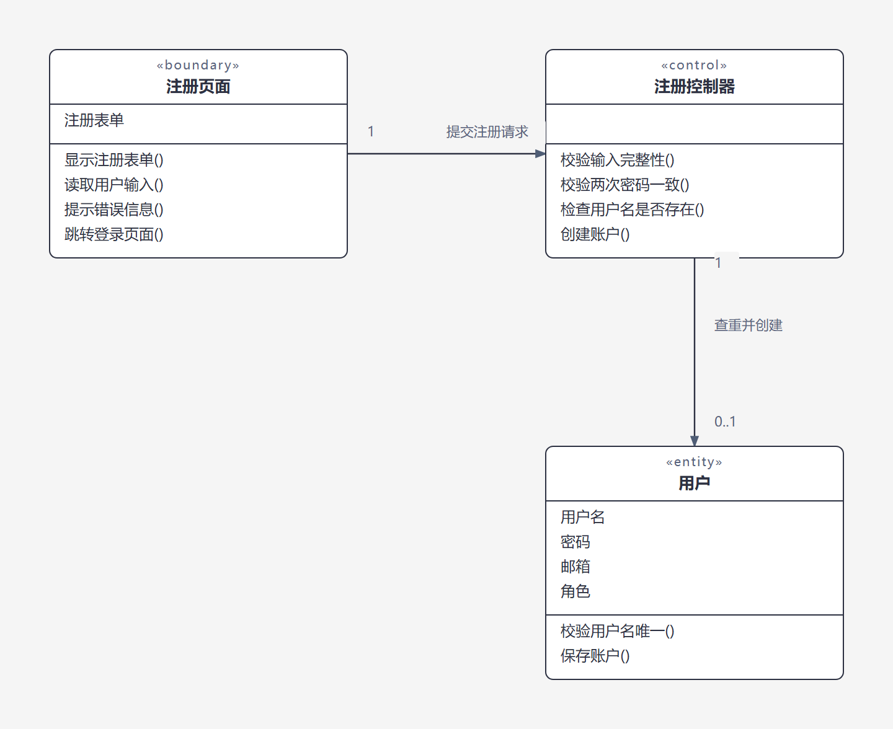

图 2-15 用户注册类模型图

用户注册按页面、控制器、用户实体分工。页面接收输入并展示结果，控制器安排输入校验与查重、创建账户，用户实体表达账户数据和相应行为。页面与控制器为 1:1；用户端 0..1 表示本次按用户名可能查不到账户，不限制系统账户总数。

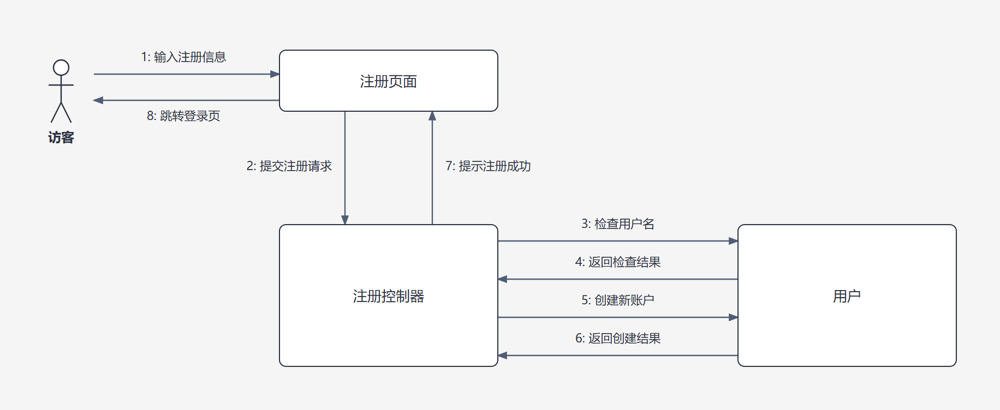

图 2-16 用户注册协作图

消息 1—2 输入并提交，3—4 查重，5—6 创建并返回结果，7—8 提示成功并显示登录页。输入不完整或两次密码不一致时不访问用户实体；用户名已存在时不执行成功消息 5—8。失败时改为提示错误并返回输入。

#### 2.3.2 用户登录

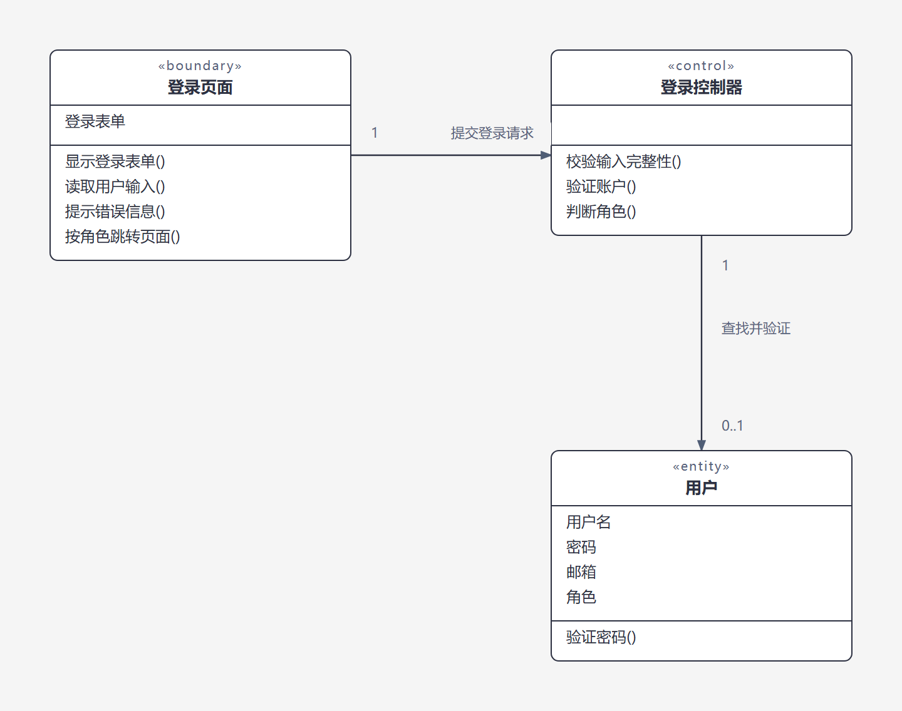

图 2-17 用户登录类模型图

用户登录按页面、控制器、用户实体分工。页面接收输入并展示结果，控制器安排输入校验与账户验证、角色判断，用户实体表达账户数据和相应行为。页面与控制器为 1:1；用户端 0..1 表示本次按用户名可能查不到账户，不限制系统账户总数。

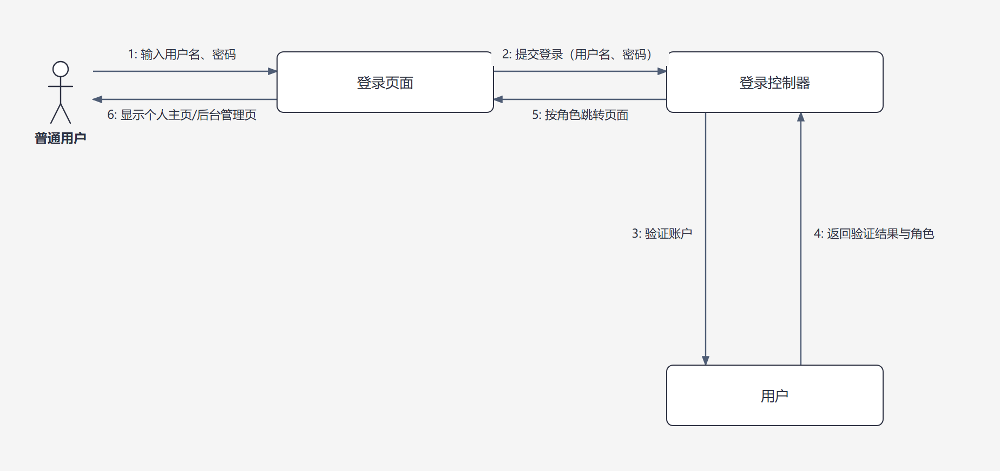

图 2-18 用户登录协作图

消息 1—2 输入并提交凭据，3—4 验证账户并返回结果及角色，成功时执行 5—6 跳转并显示对应角色页面。输入不完整时 3—6 不发生；验证失败时成功消息 5—6 不发生。参与者“登录者”包括普通用户与管理员，与“用户”实体相区分。

#### 2.3.3 创建相册

图 2-19 创建相册类模型图

创建相册页面负责表单与结果展示，相册控制器协调类别查询、校验和创建。相册与相册类别均采用统一字段：一个类别可关联零到多个相册，每个相册属于一个类别。页面与控制器为 1:1，控制器查询零到多个类别并在创建成功时保存一个相册。

图 2-20 创建相册协作图

基本消息按 1–10 编号：1 打开创建页；2 请求创建表单；3–4 查询并返回类别；5 显示表单与类别；6 用户填写后提交并由控制器校验；7–8 创建相册、关联当前用户并返回保存结果；9–10 返回成功、提示并回到列表。类别在显示表单前读取。校验失败时不执行成功路径的 7–10，由页面提示并保留输入。

#### 2.3.4 修改相册

图 2-21 修改相册类模型图

修改相册页面承担输入和展示，相册控制器查询、校验并更新相册，读取类别字典供类别选择。相册和相册类别的字段与创建用例一致。查询目标相册的多重性为 0..1，表示可能查不到；一个相册属于一个类别，一个类别可对应零到多个相册。

图 2-22 修改相册协作图

消息 1–10 依次为：选择修改、请求现有信息、查询相册、返回相册、显示现有信息、提交修改并校验、更新相册、返回更新结果、返回成功、提示并回到列表。相册不存在时在查询阶段返回错误并回到列表；名称为空时不执行更新，由页面提示并返回输入。类别字典读取已在类模型图中表示。

#### 2.3.5 上传图片

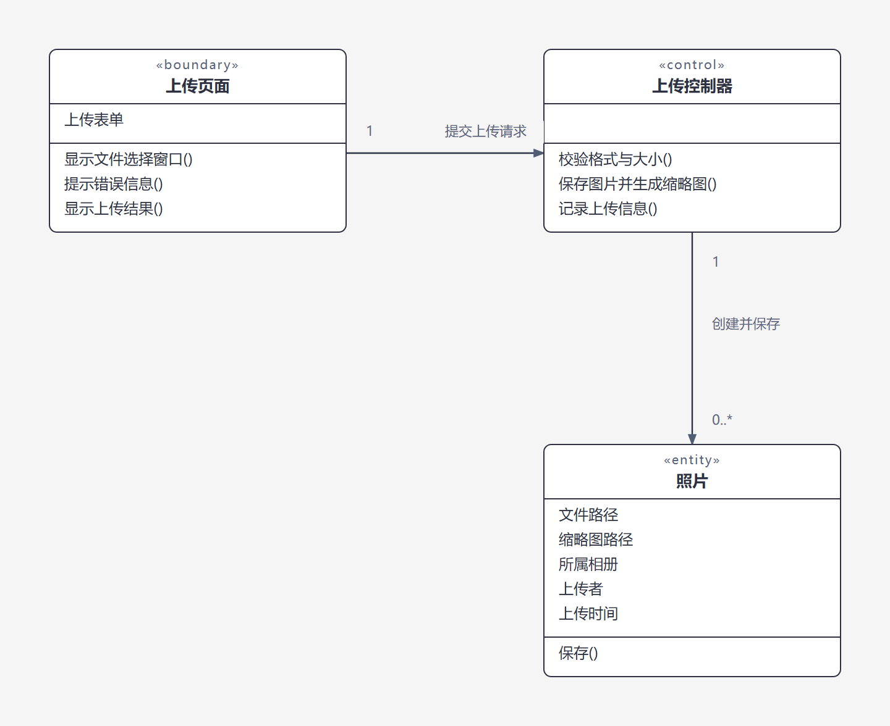

图 2-23 上传图片类模型图

上传页面负责选择文件和提示，上传控制器校验文件、协调文件保存与缩略图生成并记录信息，照片实体保存路径与元数据。照片字段与浏览、评论用例统一，包括照片编号、文件路径、缩略图路径、所属相册、上传者、上传时间。控制器可处理多次上传，因此照片端为 0..*；单次上传新增一张照片。

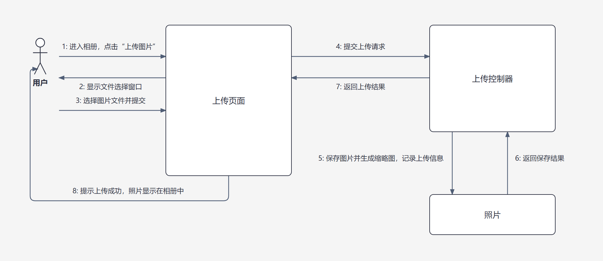

图 2-24 上传图片协作图

消息 1–6 表示进入相册并选择文件、提交并校验、保存文件与缩略图及上传信息、返回保存结果、返回上传结果、提示结果。文件选择窗口包含在页面与用户的交互中。校验不通过时跳过保存，由页面提示限制并返回文件选择。 校验失败时不执行成功路径的消息 3—6，错误提示另行返回，不据图宣称已经完成运行测试。

#### 2.3.6 浏览照片

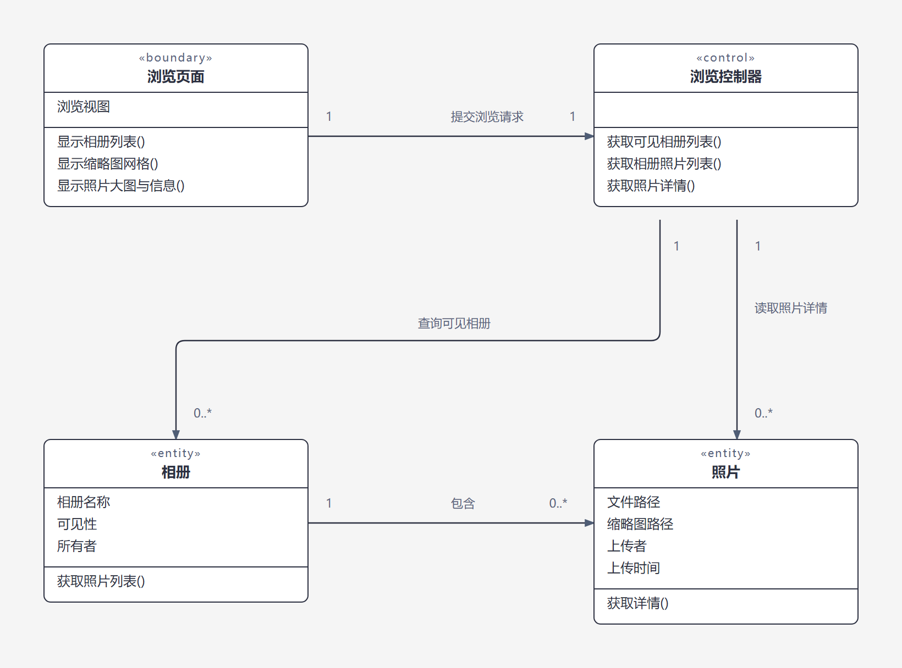

图 2-25 浏览照片类模型图

浏览页面展示列表、网格及详情，浏览控制器查询并校验访问权限。相册、照片使用跨用例统一字段。控制器可查询零到多个可见相册，读取单张照片详情的多重性为 0..1；一个相册可包含零到多张照片，包含关系的两端为 1 和 0..*。

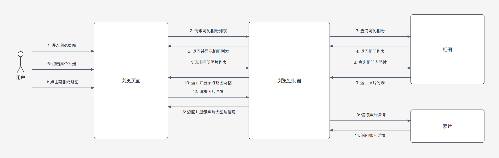

图 2-26 浏览照片协作图

消息 1–14 分三段：1–5 进入并查询、显示可见相册列表；6–9 点击相册、校验权限并读取照片、显示缩略图；10–14 点击缩略图、读取照片详情及评论并显示大图。可见相册列表为空时提示并停止后续消息；私有相册访问被拒绝时不读取照片，返回列表。链接直达从相册访问请求进入，同样执行权限校验。

#### 2.3.7 相册类别管理

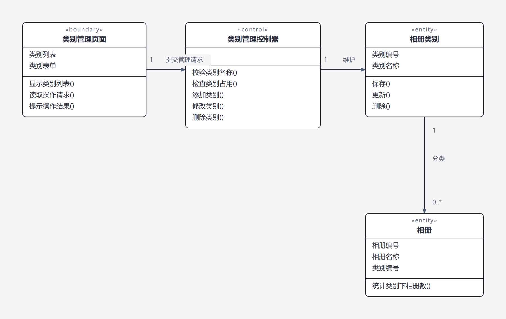

图 2-27 相册类别管理类模型图

类别管理页面为边界类，类别管理控制器负责名称校验、占用检查与增删改，相册类别及相册为实体类。实体字段与相册管理、浏览用例保持一致。一个类别可对应零到多个相册，控制器通过统计类别下的相册数决定能否删除，避免移除仍被引用的类别。

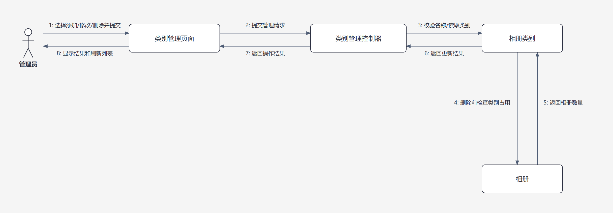

图 2-28 相册类别管理协作图

消息 1–5 先加载并显示现有类别；6 提交操作，添加或修改时校验名称；7–8 仅在删除时查询相册占用并返回数量；9–10 执行类别更新并返回结果；11–12 返回操作结果、提示并刷新列表。名称不合法或占用数量大于零时不执行 9，页面提示错误并返回相应步骤。

#### 2.3.8 对照片评论

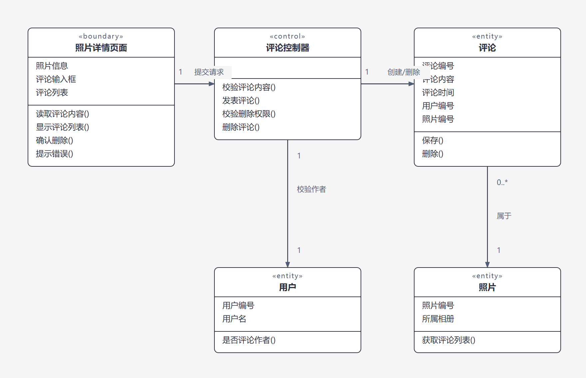

图 2-29 对照片评论类模型图

照片详情页面负责输入、展示和删除确认；评论控制器负责内容校验、发布、作者校验和删除。评论记录用户编号和照片编号，每条评论属于一个用户和一张照片，用户与照片都可关联零到多条评论。用户、照片字段与其他用例一致，照片实体提供读取评论列表的方法。

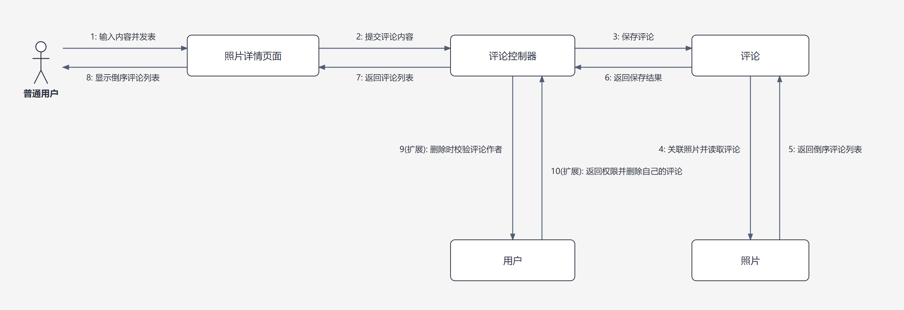

图 2-30 对照片评论协作图

基本消息 1–8：输入并发表、提交校验、保存并关联用户和照片、返回保存结果、读取照片评论、返回倒序列表、返回页面、显示列表。带 * 的 9–14 为删除扩展：页面显示确认，用户确认后才提交删除；10–11 校验当前用户是否为作者；12–13 通过后删除并返回结果；14 返回结果并刷新。取消确认不提交删除请求，作者校验失败不执行删除；输入校验失败不保存评论。

## 3 非功能需求

### 3.1 运行环境与开发环境

开发与课程演示阶段，浏览器、FastAPI 服务及 PostgreSQL Docker 容器运行在同一台开发本机。“服务器”指本机后端进程。图片及缩略图保存到 uploads/，数据库仅存路径和元数据；以后如需独立文件服务或对象存储，再在设计阶段确定迁移方案。

建议验收基准为 64 位 Windows 开发本机、至少 4 核 CPU、8GB 内存及 10GB 可用磁盘空间。该配置是后续测试的约定基线，不是已经确认的实测设备参数。浏览器以测试时安装的 Chrome、Edge 稳定版为兼容对象，记录具体版本及 1366×768、1920×1080 两种窗口下的显示情况。

前端采用 Vue 3、TypeScript 和 Vite，后端采用 Python 与 FastAPI，数据库采用 PostgreSQL Docker 容器。运行时及依赖版本在实现阶段通过依赖清单和镜像标签固定。SQLAlchemy、JWT 和 Element Plus 仍为候选方案，不在需求报告中写成已定实现。每人建立独立本地数据库，通过 seed.sql 和 demo_photos/ 初始化；uploads/、数据库数据文件和本地凭据不提交到公开仓库。

### 3.2 并发容量与响应时间

以下数值是本课程项目的建议验收目标，尚未实测。面向课堂小规模演示，基准数据拟设为 100 个普通账户、10 个类别、200 个相册、1000 张照片元数据及 2000 条评论，文件容量随样例集单独记录。使用固定种子数据、同一硬件和浏览器版本重复测试，避免把不同条件下的结果混为一谈。

负载约定为 20 个已登录会话并发访问，持续 5 分钟，用户操作间隔 1 秒。业务请求比例设为浏览 70%、创建或修改相册 10%、发表评论 10%、上传 10%；准备有效类别及不同账户，避免测试数据冲突掩盖真实性能。预期成功请求的失败比例不超过 1%，故意构造的权限拒绝和输入错误单独统计。测试记录请求数、实际并发、响应时间分布、错误类型以及 CPU 和内存使用情况。

登录、相册列表、照片元数据详情及评论提交的接口响应时间目标为 P95 不超过 2 秒。单张 10MB 以内合规图片上传并完成缩略图与元数据保存，端到端目标为 P95 不超过 5 秒，最多 2 路同时上传；上传耗时包括传输和服务端处理，单独记录本机回环测试条件，不据此推断公网性能。P95 表示 95% 的样本不超过该值；统计时只纳入对应类别的预期成功请求，另报告错误率。图片原文件下载与浏览器解码耗时另记，不混入元数据接口指标。

### 3.3 安全性与访问控制

所有受保护操作都由后端识别当前用户与角色，不信任页面是否隐藏按钮或请求中自行声明的身份。管理员账户预置，普通注册仅创建普通账户。登录失败统一提示“用户名或密码错误”；密码采用带盐单向哈希保存，日志和错误信息不记录明文密码。具体认证机制在设计阶段确定。

可浏览范围是他人公开相册和本人全部相册。列表、相册详情、照片详情、原图与缩略图访问均执行同一可见性规则，链接直达不能绕过校验。上传到本人相册、修改本人相册、删除本人评论、管理员维护类别分别核对资源所有者或账户角色；请求中的资源编号不得替代身份校验。实现后使用账户 A、账户 B、管理员和未登录请求逐项验证，检查拒绝后数据及文件是否保持不变。

服务端检查图片格式及大小，不仅依赖文件扩展名；jpg/png/gif 且不超过 10MB，边界用例包含恰好 10MB、超过 10MB 和伪装扩展名。文件名由服务端生成，存储路径限制在 uploads/ 内。评论内容非空且不超过 200 字，边界检查空串、纯空白、200 字和 201 字，并以文本形式显示以避免脚本执行。评论字数在设计时统一按 Unicode 码点统计，前后端采用相同方式；10MB 按 10×1024×1024 字节作为验收计量约定。这两项计量约定随设计评审确认，确认前不声称为原题数值细则。

### 3.4 数据完整性与异常恢复

相册、照片、评论分别保留所属用户及上级对象的标识；相册类别是共享字典，仍有相册引用的类别不得删除。用户名和类别名称的唯一性应在持久化层配合约束，避免并发检查后产生重复记录；修改类别时查重排除当前类别。关联不存在或保存失败时返回明确提示，不报告操作成功。

文件保存、缩略图生成与元数据写入需要作为一次上传结果协调处理。任一步失败应清理本次产生的临时文件或补偿已写入的数据，避免出现无元数据文件或无文件记录。后续通过模拟文件不可写、缩略图失败和数据库保存失败验证；重新打开相册确认没有半完成照片。课程演示前备份本地数据库与图片，使用同一备份集恢复后抽查路径、归属和数量。该约定属于后续设计与验证要求，当前未进行故障演练。

### 3.5 易用性与可维护性

页面统一使用中文字段和操作名称，提交前显示必要的格式、大小及长度限制；失败时保留可修正的输入并提示原因。空相册列表、无照片及无评论均显示清楚的空状态；评论删除先确认，取消后保留原记录。后续按注册、登录、创建相册、上传、浏览、评论的完整任务顺序开展人工走查，记录阻断问题及修改结果。

实现遵循 MVC 思路并参考边界、控制、实体的职责划分，将页面交互、业务校验和数据访问分开。分析类不直接等同于最终代码目录或数据库表。通过版本化依赖、统一初始化脚本、相对路径及 README 启动说明，使组员可以在独立本机复现环境；以一名组员按说明从新数据库启动并完成主要用例作为可维护性验收。上述验证均在实现完成后执行，本报告只规定目标与方法。

## 4 任务分工

### 4.1 六人职责与实际交付

本组六人为刘硕、钟标、顾圣杰、王柯涵、陈诺、翟宇豪。刘硕按现有组长职责及历史署名整理；个人学号、班级、指导教师和贡献百分比尚待组长补充确认。以下区分已留存交付与尚待本人核实的信息，不按提交次数直接折算贡献。

| 成员 | 前期工作及署名依据 | 本轮工作及确认状态 | 贡献比例 |
| --- | --- | --- | --- |
| 刘硕（组长） | 系统目标与结构、相册图稿代做、全组 v2.1 图稿返修与质量统筹 | 接手账户答辩材料，审核四组内容，整合本报告、非功能需求与 PPT；AI 辅助整理和版式检查 | 待组长核定 |
| 钟标 | 账户管理原目录保留前期分工与交付记录 | 本轮账户答辩材料由组长接手，不记为钟标本轮工作 | 待组长核定 |
| 顾圣杰 | 相册管理两用例需求初稿；现有相册图稿由刘硕完成 | 接回创建与修改相册，提供两页答辩内容和问答 | 待组长核定 |
| 王柯涵 | 照片管理原模块图文交付；v2.1 全组返修另计刘硕 | 提供上传与浏览答辩内容、讲解和问答 | 待组长核定 |
| 陈诺 | 类别管理图文，类别与评论模块整合及校对 | 整合评论典型用例材料，提交 PR #25，带翟宇豪阅读需求及整理初稿 | 待组长核定 |
| 翟宇豪 | 评论初稿及图文阅读核对按合作材料记载，待本人确认 | 评论流程、分析类、协作消息及问答初稿由陈诺统一整合，待本人确认 | 待组长核定 |

### 4.2 贡献比例核定方法

贡献比例由组长依据实际工作核定后填写，不以均分或推测值替代。核定时分别检查需求与文字、图稿与逻辑返修、模块讲解材料、统筹整合与排版等工作的实际承担者，结合交付文件、提交及 PR 记录与本人确认，避免将代做、统一返修和原有材料复用重复计算。六人最终比例之和应为 100%。

现阶段比例未获确认，因此本报告保留“待组长核定”，不能直接作为已定稿的个人贡献证明。翟宇豪尚未加入仓库，由陈诺统一提交，不设独立账号指派；入仓后的 Git 操作教学仍属后续安排，不能写成已完成。答辩前应核对成员信息、核定比例并由本人确认个人工作描述。

## 5 总结和体会

### 5.1 需求与模型一致性的困难

本阶段最具体的困难是同一条业务规则分散在用例描述、活动图、类模型图和协作图中，容易出现角色、分支或消息编号不一致。例如登录协作图原参与者写作普通用户，却同时显示管理员后台结果；审核将参与者统一为登录者，并明确验证成功后按账户角色分流，普通用户仍进入个人主页。创建相册还需要在表单显示前读取类别，不能把查询放在保存之后。

处理时先核对题目与既定范围，再逐个对照前置条件、异常分支、类职责和成功消息。校验失败后不再执行保存或成功跳转，而错误提示不套用成功路径的消息含义。相册修改的消息总数已核对为 1—10；评论的基本流程 1—8 与带星号的删除扩展 9—14 分开解释，确认取消与作者校验失败的停止点。

### 5.2 协作与表达的收获

相册模块接回时，顾圣杰对照刘硕已有图稿重新核对类名与编号，保留实际绘图署名；照片模块将文件与元数据分开说明，避免把路径记录误说成数据库保存图片；陈诺将评论作为两页贯穿用例，同时保留类别字典的名称与占用规则，避免讲解主次失衡。账户材料由组长接手，未把代写工作或个人体会记到未参与本轮的成员名下。

这些核对说明，分工目录只能表明组织方式，实际贡献仍须结合交付记录确认。共享色板、字号、走线和脚本生成流程减少了图稿样式差异，统一编号与图后说明使读者能把图与规则对应起来。两页材料也帮助各组从“操作怎样完成”过渡到“哪些对象协作完成”，而不是只读图名或罗列类名。

### 5.3 阶段成果与后续工作

本报告完成系统目标、八个用例的功能描述、活动图及分析模型的整合，并提出可验证的非功能目标；答辩 PPT 按十分钟主讲安排，模型细节放入备用页。上述内容是需求分析成果，不表示系统已经实现，也不表示性能、权限或恢复测试已经通过。

下一阶段需要完成面向对象设计，确定接口、数据库约束、照片存储处理及认证选型，再按 Vue、FastAPI、PostgreSQL 的技术路线实现。贡献比例、个人信息和翟宇豪工作确认仍待补齐；真实计时试讲及据此调整必须由汇报人完成。临时答辩目录在确认正式材料和必要过程记录均已留存后才可清理，本次保留原交付与生成脚本。
