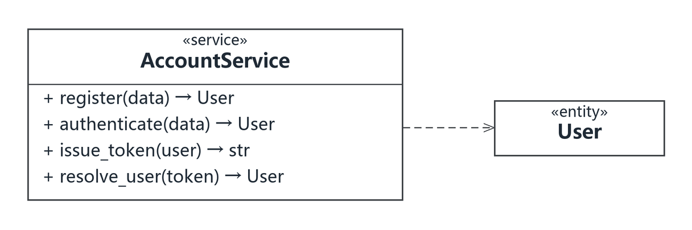
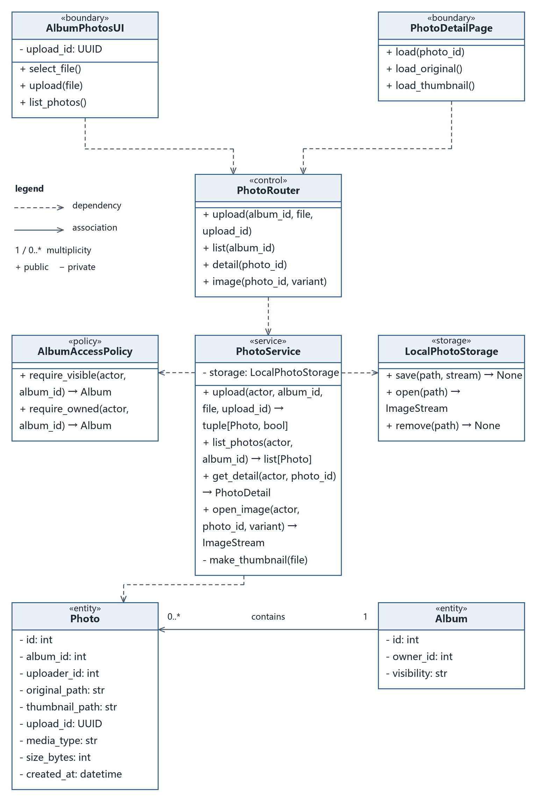
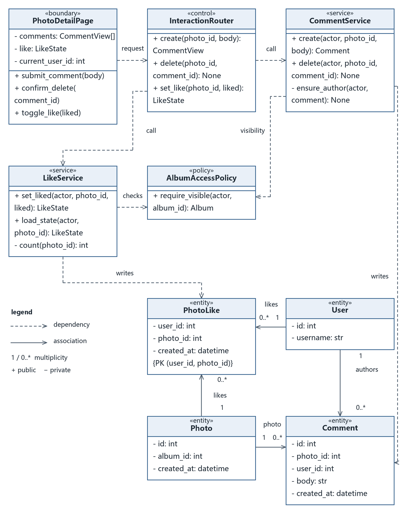

# 设计类图

## 图 02 全局领域实体类图

每张照片属于一个相册，相册可以为空。评论与点赞都关联用户和照片，同一用户对同一张照片最多有一条点赞记录。

## 图 03 账户管理设计类图

账户服务负责注册、凭据验证和会话处理。

## 图 04 相册管理设计类图

相册服务处理创建和修改，访问策略校验可见性或归属。类别服务删除前查询相册引用，数据库外键在并发写入时仍会阻止删除已被引用的类别。

## 图 05 照片管理设计类图

照片服务通过访问策略检查相册权限。上传时由照片服务生成缩略图，由其持有的本地存储对象保存原图和缩略图。

## 图 06 评论与点赞设计类图

本图覆盖「对照片评论」与「对照片点赞」两个用例，按「界面 → 控制入口 → 服务 → 访问策略 → 实体」分层。上排左起依次是 PhotoDetailPage（«boundary»，Vue 照片详情页，持有 comments、like 与 current_user_id）、InteractionRouter（«control»，评论与点赞路由，三个操作对应发表评论、删除评论、设置点赞三个接口）和 CommentService（«service»）；第二排是 LikeService 与 AlbumAccessPolicy（«policy»，提供相册可见性判断）；下部四个实体按相邻关系摆放：PhotoLike 与 Photo 在中列、User 与 Comment 在右列，四条关联正好连成一个环。虚线带空心箭头是调用依赖，实线带空心箭头是业务关联（箭头指向 0..* 端），关联名与两端多重性同放在线的上方，图例见左下角。

实体的字段按本模块的使用范围裁剪：`Comment` 保留 `id`、`photo_id`、`user_id`、`body`、`created_at`；`PhotoLike` 保留 `user_id`、`photo_id`、`created_at`，并以 `{PK (user_id, photo_id)}` 标出联合主键；`Photo` 只需要 `id` 与 `album_id`，因为评论和点赞都要先用照片所属相册复核可见性；`User` 只需要 `id` 与 `username`，用于回显评论作者和点赞人。服务只列关键操作：`CommentService.create`/`delete` 与 `LikeService.set_liked`/`load_state` 对应接口，`ensure_author` 与 `count` 是服务内部的归属校验和计数。`InteractionRouter` 对应包图中的「评论与点赞路由」，评论接口与点赞接口共用这一个入口，按路径和方法分派到两个服务。

**发表评论与删除本人评论。** 页面调用 `submit_comment(body)`，路由以 `create(photo_id, body)` 转交服务。`CommentService.create` 先按照片记录的 `album_id` 调 `AlbumAccessPolicy.require_visible`，照片不存在或当前不可见即返回 `404 PHOTO_UNAVAILABLE`；再把正文去首尾空白，校验 1–200 字符；最后在事务内写入 `photo_id`、当前用户的 `user_id`、正文和创建时间，返回的 `CommentView` 由页面追加到列表尾部。删除评论分两步校验：先用路径中的 `photo_id` 与 `comment_id` 定位记录，评论不存在或属于另一张照片时返回 `404 COMMENT_NOT_FOUND`；再由 `ensure_author` 比较 `comment.user_id` 与当前 `actor.id`，不相等返回 `403 COMMENT_NOT_OWNED`。页面只按 `author.id == current_user_id` 显示删除入口，服务端的这次比较才是最终判据，改请求参数也删不掉他人评论。

**点赞、重复点赞与取消点赞。** 三个动作都由 `LikeService.set_liked(actor, photo_id, liked)` 处理，写入前同样先按 `Photo.album_id` 复核可见性。`photo_likes` 以 `(user_id, photo_id)` 为联合主键，一个用户对一张照片最多一条记录，因此同一用户对同一照片的三次操作结果如下。

| 操作 | 请求 | 事务内写入 | 返回 |
| --- | --- | --- | --- |
| 点赞 | `liked = true` | 按联合主键插入 `user_id`、`photo_id`、`created_at` | `liked = true`，`like_count` 加 1 |
| 重复点赞 | `liked = true` | 联合主键冲突，保留原记录与原创建时间，不新增 | `liked = true`，`like_count` 不变 |
| 取消点赞 | `liked = false` | 按联合主键删除本人记录，记录已不存在时视为已取消 | `liked = false`，`like_count` 减 1 或保持 |
| 读取状态 | `GET /api/photos/{photo_id}` | 不写入 | `load_state` 返回同一口径的 `LikeState` |

本人状态和点赞数在同一次查询中取得：`count(photo_id)` 统计该照片的记录数作为 `like_count`，再判断本人的联合键记录是否存在作为 `liked`，两者组成 `LikeState`，随事务提交后返回，页面用回包更新按钮与计数。重复点赞和重复取消都按幂等处理，连续点击既不会产生第二条记录，也不会返回错误。

**与其他图稿的口径。** 多重性与图 02 全局领域实体类图、《公共设计约定》第 4 节一致：`User` 1 对 0..* `Comment`（authors）、`Photo` 1 对 0..* `Comment`（has comments）、`User` 1 对 0..* `PhotoLike`（likes）、`Photo` 1 对 0..* `PhotoLike`（has likes），`PhotoLike` 的联合主键与 ER 图的 `photo_likes` 表一致。操作名与图 14、图 15 两张顺序图对应：评论侧为 `create`、`delete`、`require_visible`，点赞侧为 `set_liked` 以及内部的插入、删除和状态查询。
