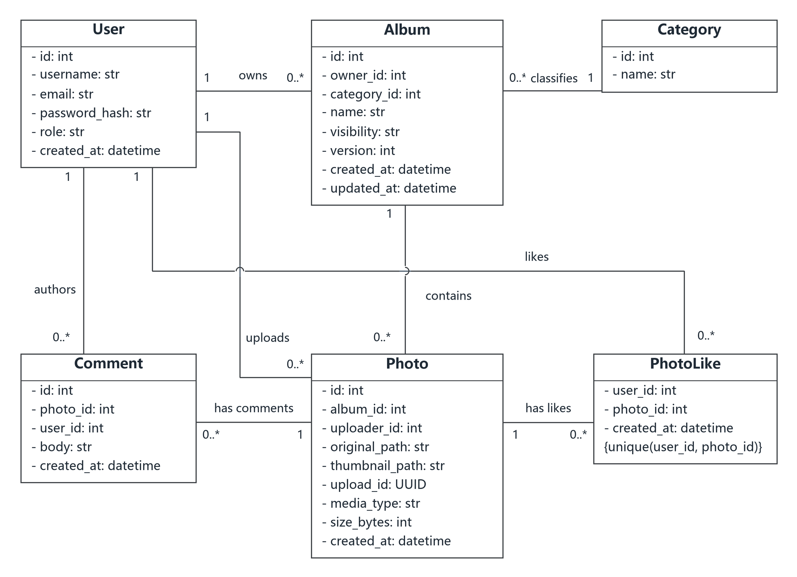
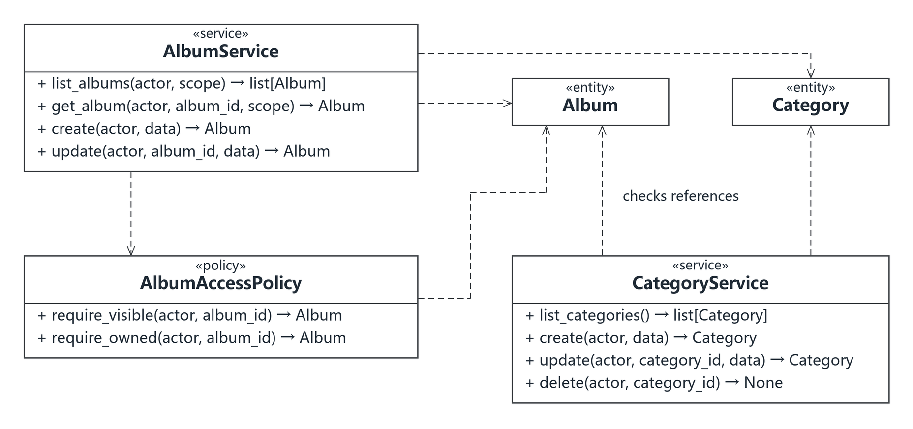

# 设计类图

## 图 02 全局领域实体类图

每张照片属于一个相册，相册可以为空。评论与点赞都关联用户和照片，同一用户对同一张照片最多有一条点赞记录。

## 图 03 账户管理设计类图

账户服务负责注册、凭据验证和会话处理。

## 图 04 相册管理设计类图

相册服务处理创建和修改，访问策略校验可见性或归属。类别服务删除前查询相册引用，数据库外键在并发写入时仍会阻止删除已被引用的类别。

## 图 05 照片管理设计类图

照片服务通过访问策略检查相册权限。上传时由照片服务生成缩略图，由其持有的本地存储对象保存原图和缩略图。

## 图 06 评论与点赞设计类图

评论和点赞服务共用相册可见性检查，分别管理评论记录和点赞记录。
