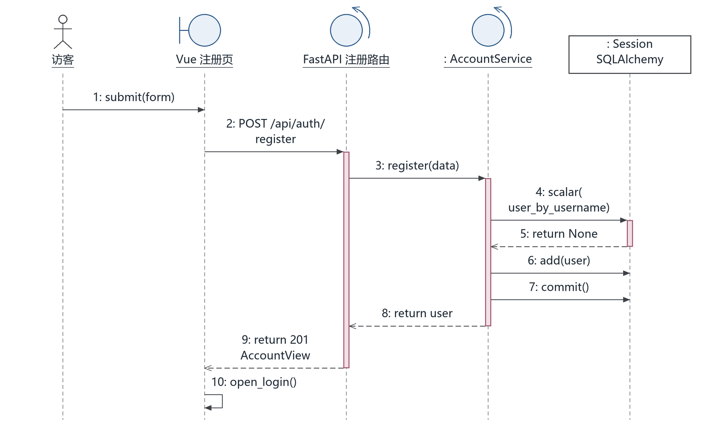
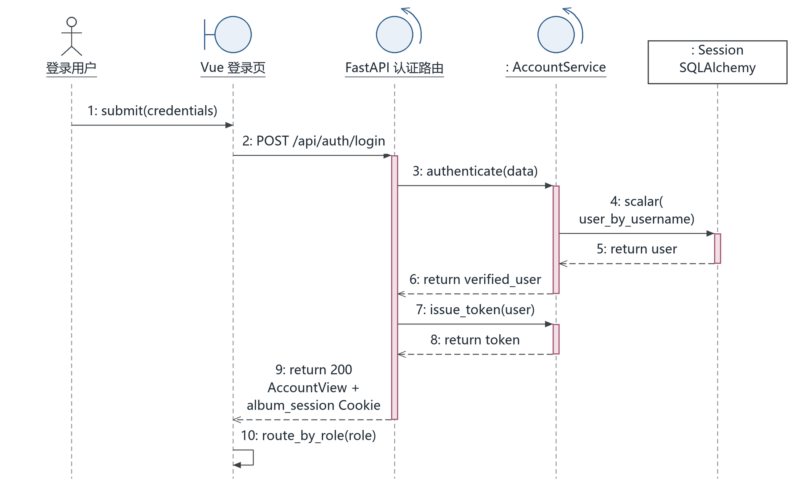
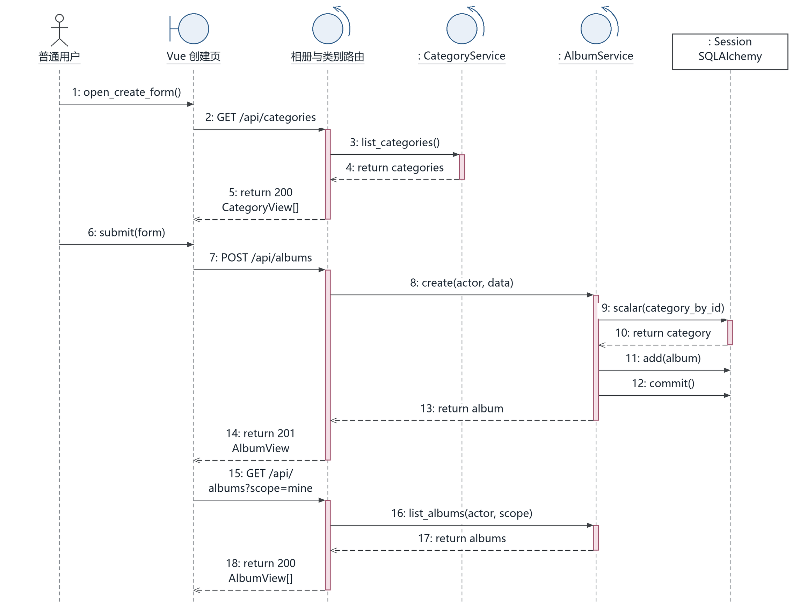
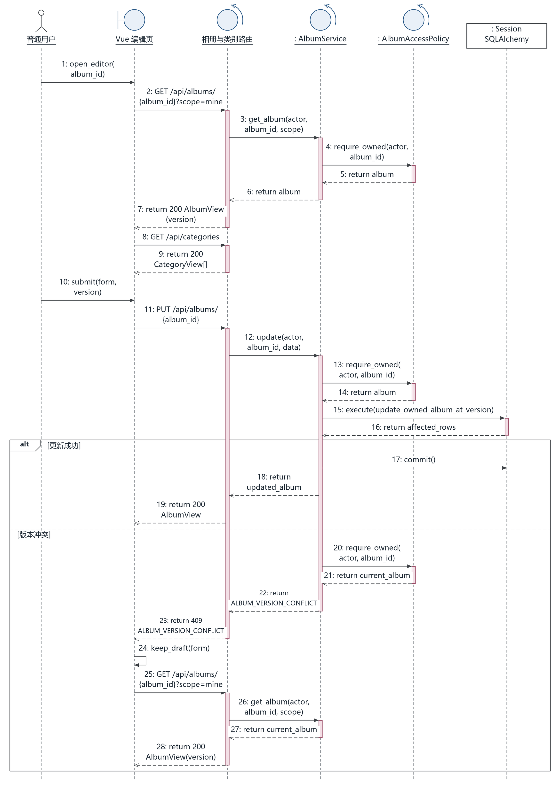
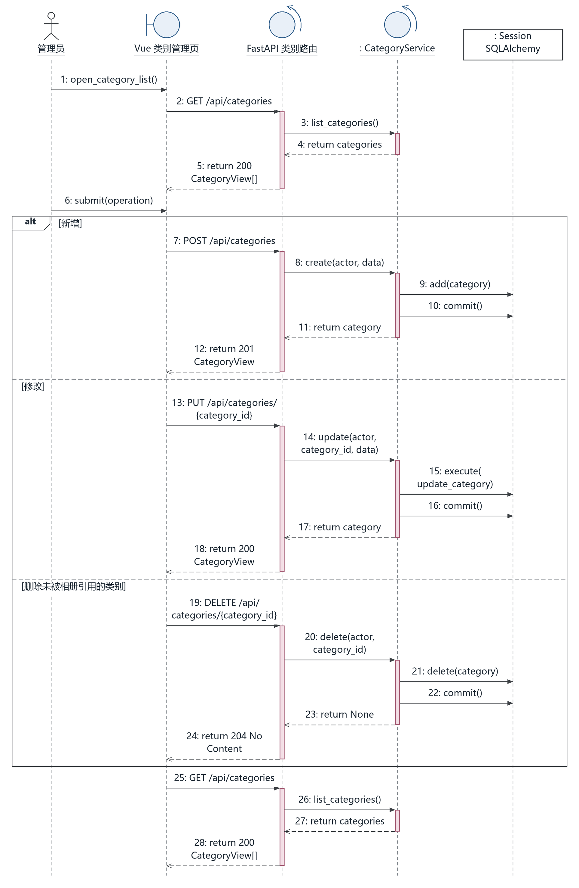
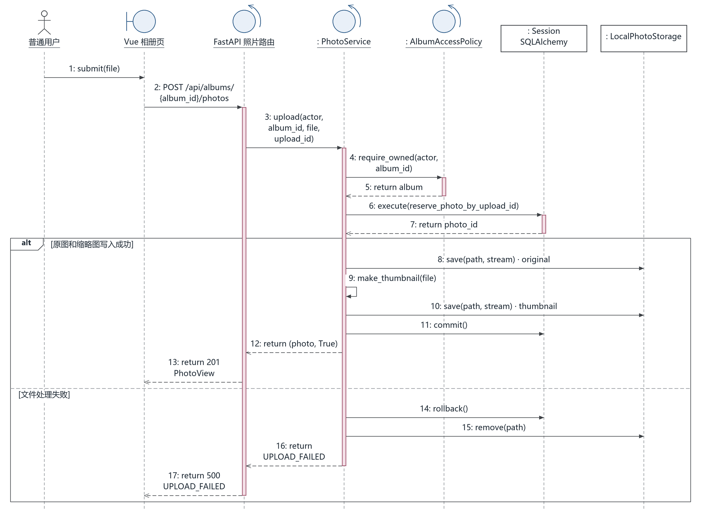
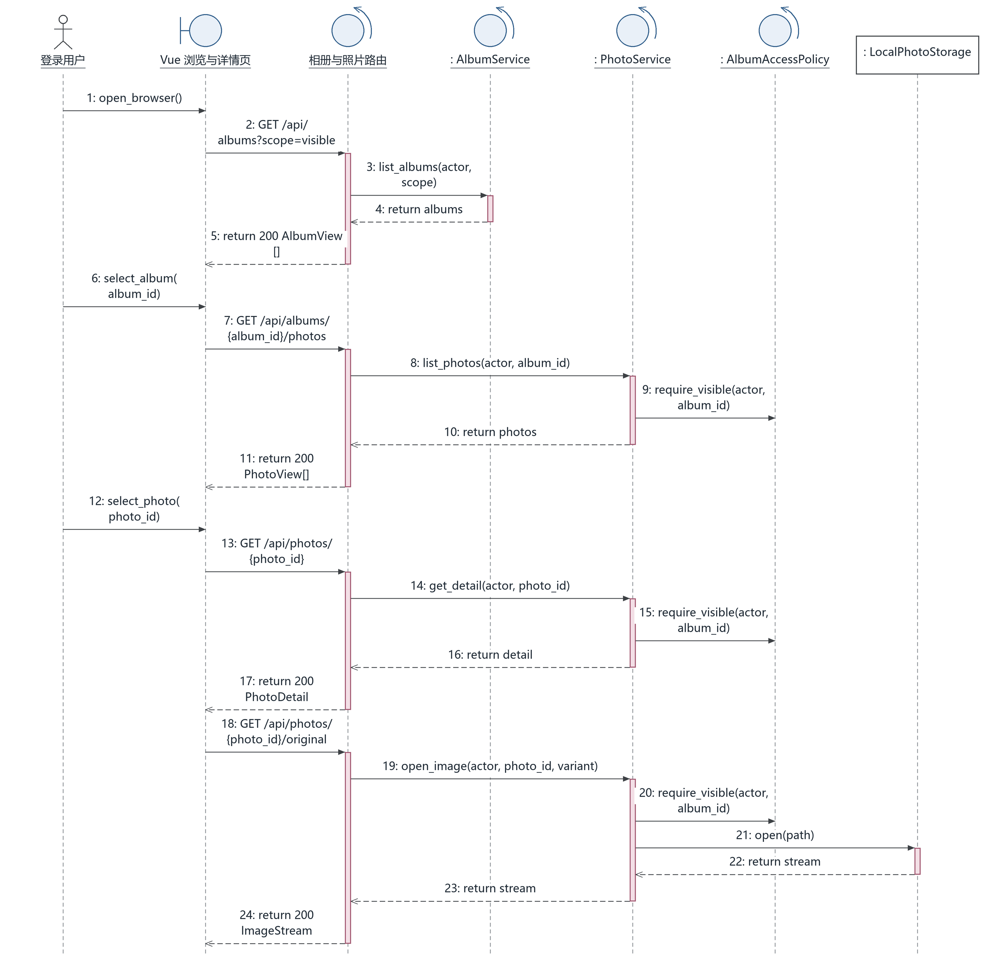
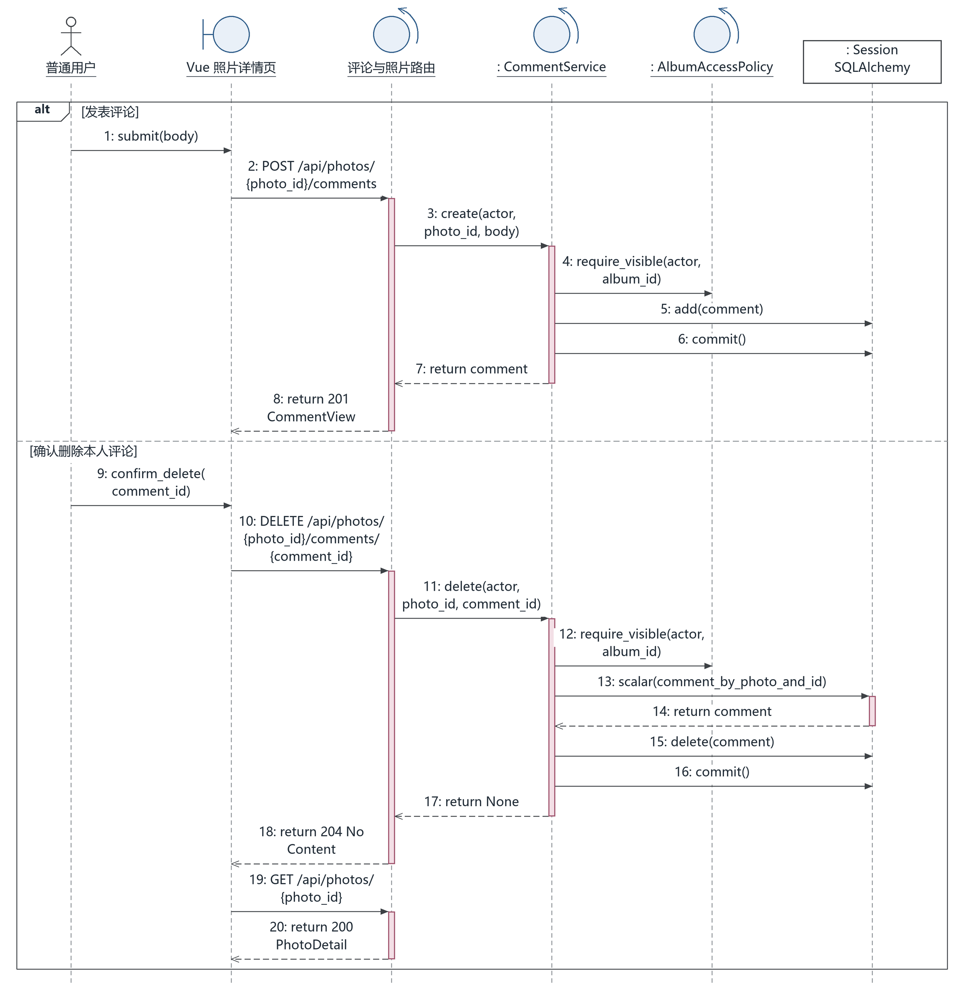
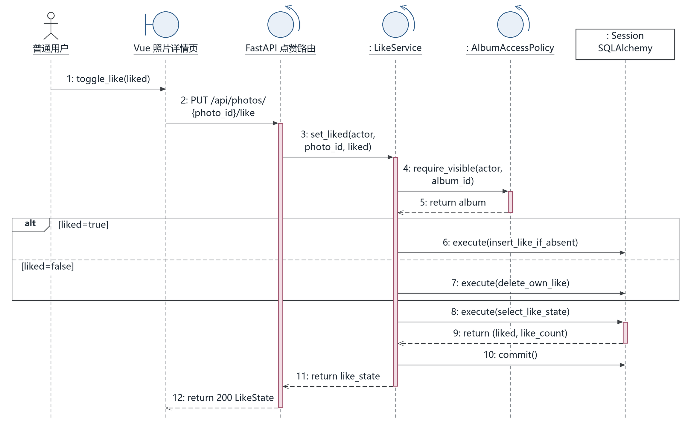

# 顺序图

## 图 07 用户注册顺序图

账户服务校验表单，写入含密码哈希的普通账户，成功后进入登录页。

## 图 08 用户登录顺序图

凭据验证成功后签发会话令牌，页面按账户角色跳转。

## 图 09 创建相册顺序图

页面加载类别，服务按当前用户建立相册，成功后刷新本人列表。

## 图 10 修改相册顺序图

更新时核对归属和版本，版本冲突后保留草稿并重新读取相册。

## 图 11 相册类别管理顺序图

管理员选择新增、修改或删除类别，成功后刷新列表。

## 图 12 上传图片顺序图

新上传在原图和缩略图就绪后提交，文件处理失败时回滚并清理本次文件。

## 图 13 浏览照片顺序图

相册、照片详情与图片读取逐次校验可见性，原图和缩略图共用读图方法。

## 图 14 对照片评论顺序图

发布后加入新评论，确认删除本人评论后重新读取详情。

## 图 15 对照片点赞顺序图

点赞和取消写入指定状态，提交后返回本人状态和点赞总数。
