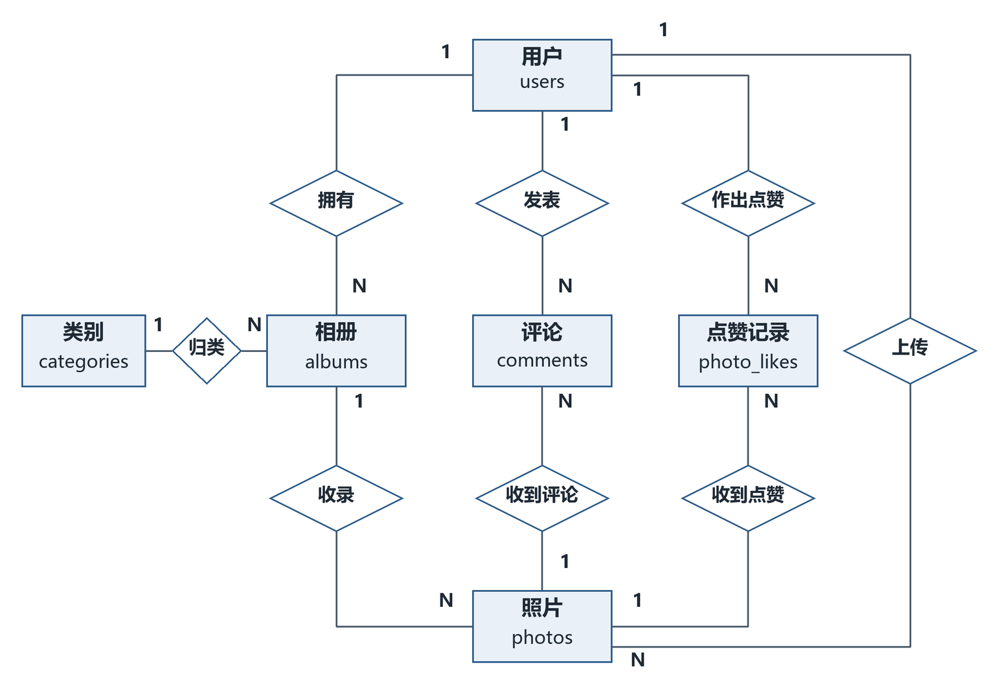

# 数据库设计

## 图 16 PostgreSQL 数据库 ER 图

本图采用 Chen 表示法。矩形是实体，菱形是关系。连线两端的 `1` 和 `N` 表示一对多，从 `N` 端读回去就是多对一。例如，一个相册可以有零张或多张照片，每张照片必须属于一个相册。图中 `N` 允许为零。

用户和照片通过「点赞记录」形成多对多关系。每条点赞记录关联一个用户和一张照片，用户和照片各自都可以对应多条点赞记录。字段、主外键和唯一约束见下方字典。[可编辑 Draw.io 源图](图稿/数据库/16_PostgreSQL数据库ER图.drawio) · [SVG](图稿/数据库/16_PostgreSQL数据库ER图.svg) · [生成脚本](../../tools/design_diagrams.py)

## 关系与多重性

| 父端（`1`） | 子端（`0..*`） | 子表外键 | 含义 |
| --- | --- | --- | --- |
| `User` / `users` | `Album` / `albums` | `owner_id` | 用户拥有相册 |
| `Category` / `categories` | `Album` / `albums` | `category_id` | 类别对相册分类，可暂未使用 |
| `Album` / `albums` | `Photo` / `photos` | `album_id` | 相册收录照片，可为空 |
| `User` / `users` | `Photo` / `photos` | `uploader_id` | 用户上传照片 |
| `User` / `users` | `Comment` / `comments` | `user_id` | 用户发表评论 |
| `Photo` / `photos` | `Comment` / `comments` | `photo_id` | 照片可收到评论 |
| `User` / `users` | `PhotoLike` / `photo_likes` | `user_id` | 用户对照片点赞 |
| `Photo` / `photos` | `PhotoLike` / `photo_likes` | `photo_id` | 照片可收到点赞 |

上表各外键均引用对应父表的 `id`。`albums.category_id` 使用 `ON DELETE RESTRICT`。其余外键使用 PostgreSQL 默认的 `NO ACTION`，在本期用例范围内相关父记录没有删除入口。

## 字段字典

类型沿用[公共设计约定第 4 节](01_公共设计约定.md#4-数据字典)。独立实体的整数标识由数据库使用 `GENERATED BY DEFAULT AS IDENTITY` 生成。`timestamptz` 表示 `timestamp with time zone`。新建时使用数据库事务时间 `CURRENT_TIMESTAMP`，接口按 UTC 的 ISO 8601 格式返回。“—”表示字段没有额外的键约束。

### users

| 字段 | 含义 | PostgreSQL 类型 | 可空 | 默认值或生成方式 | 键和约束 |
| --- | --- | --- | --- | --- | --- |
| `id` | 用户标识 | `integer` | 否 | 数据库生成 | PK |
| `username` | 登录用户名 | `varchar(32)` | 否 | 服务去除首尾空白后写入 | UNIQUE，按大小写区分 |
| `email` | 联系邮箱 | `varchar(254)` | 否 | 服务验证格式后写入 | — |
| `password_hash` | 带盐密码哈希 | `text` | 否 | 账户服务生成 | — |
| `role` | 用户角色 | `varchar(16)` | 否 | 注册服务写入 `member`，初始化数据可写入 `admin` | CHECK 值为 `member` 或 `admin` |
| `created_at` | 创建时间 | `timestamptz` | 否 | `CURRENT_TIMESTAMP` | — |

### categories

| 字段 | 含义 | PostgreSQL 类型 | 可空 | 默认值或生成方式 | 键和约束 |
| --- | --- | --- | --- | --- | --- |
| `id` | 类别标识 | `integer` | 否 | 数据库生成 | PK |
| `name` | 类别名称 | `varchar(50)` | 否 | 服务去除首尾空白后写入 | UNIQUE，按大小写区分 |

### albums

| 字段 | 含义 | PostgreSQL 类型 | 可空 | 默认值或生成方式 | 键和约束 |
| --- | --- | --- | --- | --- | --- |
| `id` | 相册标识 | `integer` | 否 | 数据库生成 | PK |
| `owner_id` | 相册所有者 | `integer` | 否 | 取当前用户标识 | FK → `users.id` |
| `category_id` | 相册类别 | `integer` | 否 | 校验表单中的类别后写入 | FK → `categories.id`，限制删除引用中的类别 |
| `name` | 相册名称 | `varchar(100)` | 否 | 服务去除首尾空白后写入 | — |
| `visibility` | 可见性 | `varchar(7)` | 否 | 取提交值 | CHECK 值为 `public` 或 `private` |
| `version` | 编辑版本号 | `integer` | 否 | 新建默认 `1`，成功更新时原子递增 | CHECK `version >= 1` |
| `created_at` | 创建时间 | `timestamptz` | 否 | `CURRENT_TIMESTAMP` | — |
| `updated_at` | 最近保存时间 | `timestamptz` | 否 | 新建默认 `CURRENT_TIMESTAMP`，更新语句赋当前事务时间 | — |

### photos

| 字段 | 含义 | PostgreSQL 类型 | 可空 | 默认值或生成方式 | 键和约束 |
| --- | --- | --- | --- | --- | --- |
| `id` | 照片标识 | `integer` | 否 | 数据库生成 | PK |
| `album_id` | 所属相册 | `integer` | 否 | 服务验证归属后写入 | FK → `albums.id`，上传联合唯一键的一列 |
| `uploader_id` | 上传者 | `integer` | 否 | 取当前用户标识 | FK → `users.id`，上传联合唯一键的一列 |
| `original_path` | 原图相对路径 | `text` | 否 | 由照片服务按文件存储约定生成 | — |
| `thumbnail_path` | 缩略图相对路径 | `text` | 否 | 由照片服务按文件存储约定生成 | — |
| `upload_id` | 一次选图的上传标识 | `uuid` | 否 | 客户端选图时生成，重试沿用 | 上传联合唯一键的一列 |
| `media_type` | 原图媒体类型 | `varchar(32)` | 否 | 服务按解码识别结果写入 | — |
| `size_bytes` | 原图文件大小 | `integer` | 否 | 服务按实际字节数写入 | CHECK `size_bytes BETWEEN 1 AND 10000000` |
| `created_at` | 上传记录创建时间 | `timestamptz` | 否 | `CURRENT_TIMESTAMP` | — |

上传联合唯一键为 `UNIQUE (album_id, uploader_id, upload_id)`。

### comments

| 字段 | 含义 | PostgreSQL 类型 | 可空 | 默认值或生成方式 | 键和约束 |
| --- | --- | --- | --- | --- | --- |
| `id` | 评论标识 | `integer` | 否 | 数据库生成 | PK |
| `photo_id` | 被评论的照片 | `integer` | 否 | 服务验证照片访问权限后写入 | FK → `photos.id` |
| `user_id` | 评论作者 | `integer` | 否 | 取当前用户标识 | FK → `users.id` |
| `body` | 评论正文 | `varchar(200)` | 否 | 服务去除首尾空白并检查长度后写入 | — |
| `created_at` | 发表时间 | `timestamptz` | 否 | `CURRENT_TIMESTAMP` | — |

### photo_likes

| 字段 | 含义 | PostgreSQL 类型 | 可空 | 默认值或生成方式 | 键和约束 |
| --- | --- | --- | --- | --- | --- |
| `user_id` | 点赞用户 | `integer` | 否 | 取当前用户标识 | 联合 PK，FK → `users.id` |
| `photo_id` | 被点赞的照片 | `integer` | 否 | 服务验证照片访问权限后写入 | 联合 PK，FK → `photos.id` |
| `created_at` | 点赞时间 | `timestamptz` | 否 | `CURRENT_TIMESTAMP`，重复点赞保留原值 | — |

联合主键为 `PRIMARY KEY (user_id, photo_id)`。

## 查询与索引

| 表 | B-tree 键 | 对应查询 |
| --- | --- | --- |
| `users` | `UNIQUE (username)` | 登录按用户名读取账户，注册判断用户名冲突 |
| `categories` | `UNIQUE (name)` | 类别新增和修改时判断名称冲突 |
| `albums` | `(owner_id, id DESC)` | 按标识倒序列出本人相册 |
| `albums` | `(category_id)` | 检查类别是否被引用 |
| `photos` | `(album_id, id DESC)` | 按标识倒序列出相册内照片 |
| `photos` | `UNIQUE (album_id, uploader_id, upload_id)` | 并发上传去重及按原标识重试 |
| `comments` | `(photo_id, created_at DESC, id DESC)` | 按照片取得评论，时间相同时按标识倒序 |
| `photo_likes` | `PRIMARY KEY (user_id, photo_id)` | 查询本人点赞状态，取消本人点赞 |
| `photo_likes` | `(photo_id)` | 统计某张照片的点赞数 |

主键和唯一约束自带索引。

## 约束与服务校验

| 规则 | 数据库保障 | 服务层行为 |
| --- | --- | --- |
| 用户名唯一 | `UNIQUE (username)` 约束并发提交 | 对用户名去除首尾空白并校验 1–32 字符，处理唯一冲突并返回 `409 USERNAME_TAKEN` |
| 使用中的类别禁止删除 | `albums.category_id` 的外键限制删除 | 验证管理员角色并检查引用，处理并发外键冲突并返回 `409 CATEGORY_IN_USE` |
| 相册版本检查 | 原子更新同时匹配相册标识、所有者及旧版本，并递增版本 | 打开及提交时检查归属，若相册仍归本人但版本有变化，返回 `409 ALBUM_VERSION_CONFLICT` |
| 上传请求去重 | 三列联合唯一键仲裁并发预留 | 校验本人与相册的归属、大小及实际文件格式。同键已提交时返回已有照片，重试复用 `upload_id` |
| 点赞联合主键 | 每个用户和照片的组合最多保留一行 | 检查照片可见性。点赞时保留已有记录，取消时按联合键删除本人记录。一次查询返回是否已点赞和总数 |
| 删除本人评论 | 外键保证评论关联有效的照片和作者 | 验证照片可见性，按照片及评论标识定位记录，再比较当前用户标识与作者标识 |

`original_path` 与 `thumbnail_path` 均相对于 `uploads/`。相册 `album_id` 下每次新的写入尝试有独立的 `file_key`，原图为 `albums/{album_id}/{file_key}/original.<ext>`，缩略图为同目录的 `thumbnail.png`。服务保存原始字节与 PNG 缩略图，两份文件写完后提交记录。事务结果未知时保留文件供重试和启动核对，数据库记录中的路径也用于恢复核对。图片请求通过受保护的 API 读取，服务按相册权限判断可见性。[上传与恢复流程](02_用例详细设计/照片管理/06_上传图片.md) · [系统验收与恢复设计](03_系统验收与恢复设计.md)
